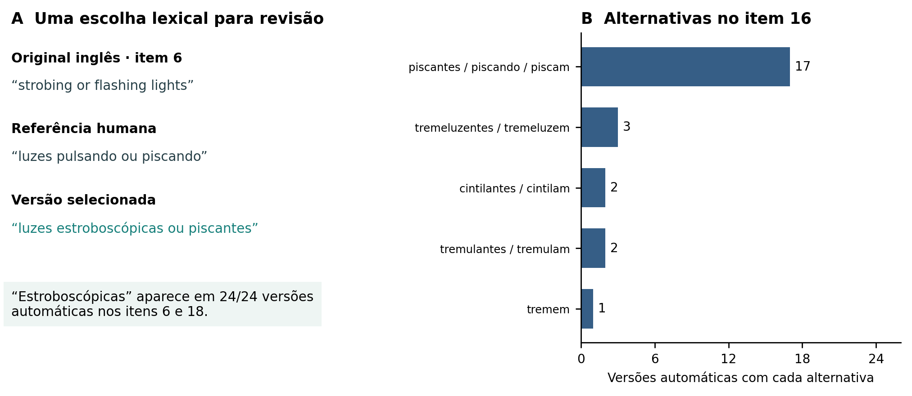

{width=16cm}

**Figura S1.** A: exemplo de formulação do item 6 no original inglês, na referência humana e na versão Deepseek-v3.2-deepthink. A expressão “estroboscópicas” aparece nas 24 versões automáticas dos itens 6 e 18. B: alternativas lexicais para *flickering* no item 16. As contagens se referem às versões de tradução, não aos participantes; alternativas podem coocorrer na mesma frase. A frequência de um termo e a proximidade dos scores não demonstram sua compreensão pelo público-alvo.

Os exemplos identificam pontos para revisão semântica e linguística. Não se
atribuiu automaticamente maior qualidade a uma das formulações. A referência
humana e as candidatas foram preservadas como estão no corpus. As frases do
painel A são trechos, não os itens completos.
