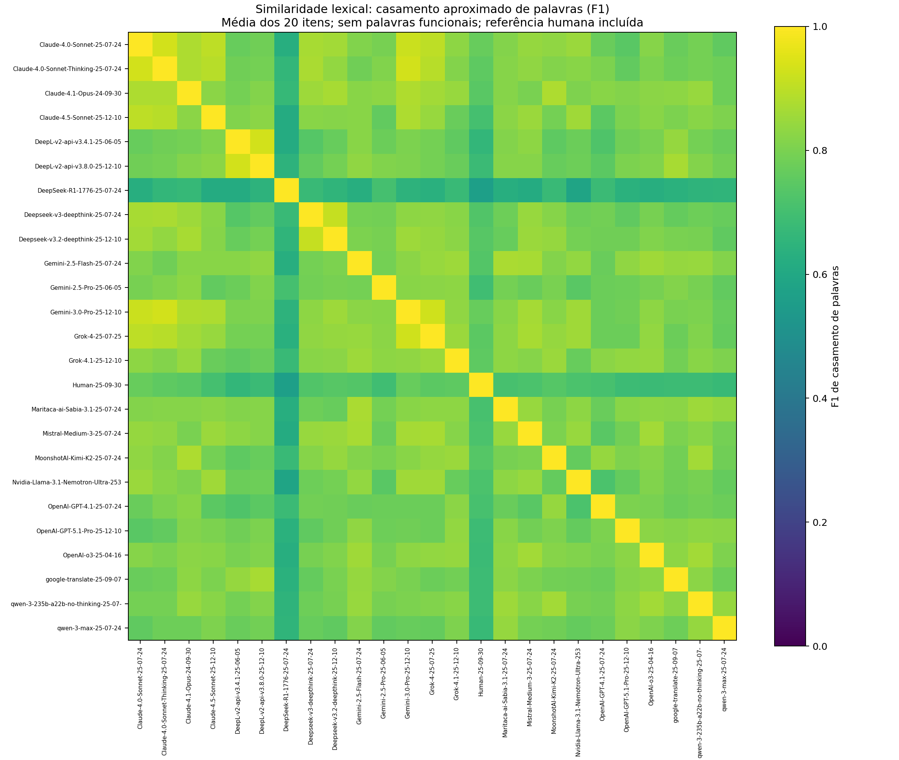
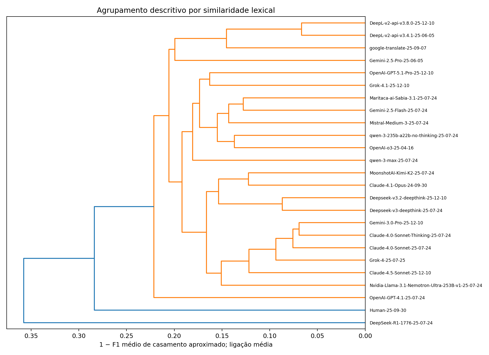
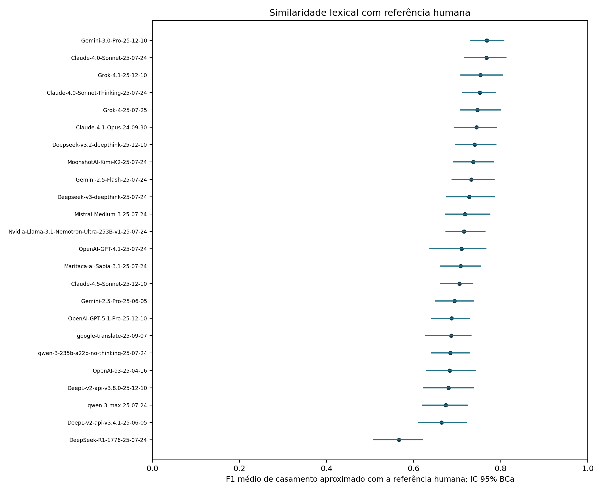
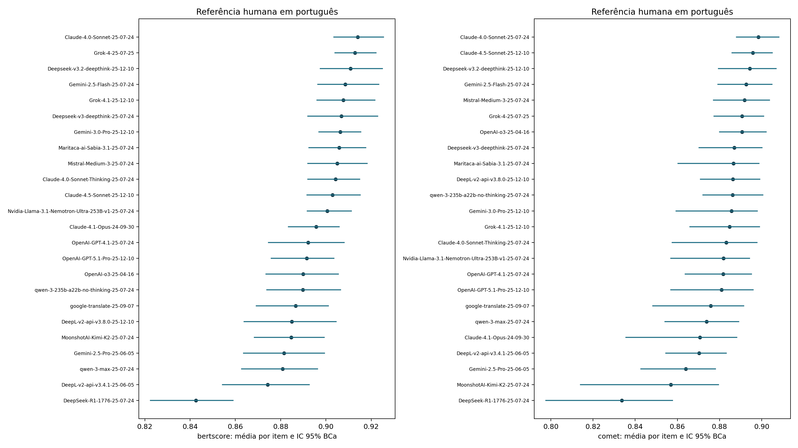
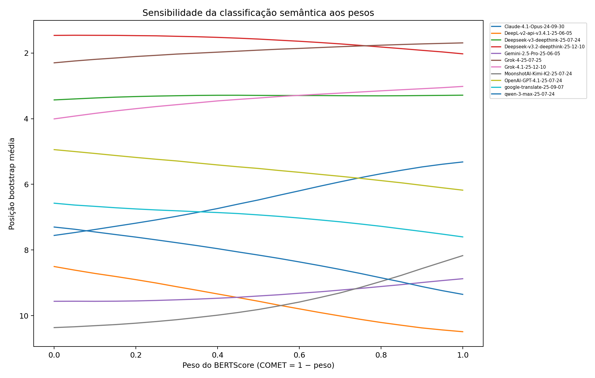

# Sensibilidade e semelhança das traduções do CHYPS-V

Estado desta execução: **complete**. Protocolo: `human-reference-item-v1`.

## O que foi medido

24 candidatas automáticas; 20 itens alinhados; referência humana excluída dos rankings. Cada comparação entre duas candidatas preserva o mesmo item. O bloco de instruções é complementar e descritivo.

Os scores lexicais quantificam palavras e estrutura compartilhadas. Não validam equivalência semântica ou clínica. A análise não assume que as traduções sejam equivalentes nem que exista um vencedor.

## Síntese da semelhança entre traduções automáticas

Foram avaliados 276 pares de candidatas em 5520 pares de itens. O F1 médio de palavras compartilhadas foi 0.7844; o casamento aproximado elevou a média para 0.7995. Entre pares de candidatas, o F1 aproximado variou de 0.5821 a 0.9334.

Em 539 pares de itens, o multiconjunto de palavras de conteúdo foi idêntico após normalização; 25 desses pares tinham ordem diferente. Esses números não se referem a igualdade literal dos arquivos.

ICs abaixo reamostram as 20 perguntas, após calcular a semelhança média dos pares dentro de cada pergunta. Os milhares de pares não foram tratados como observações independentes.

| metric | mean | percentile_low | percentile_high | bca_low | bca_high | bca_status | n_items |
| --- | --- | --- | --- | --- | --- | --- | --- |
| jaccard | 0.6660 | 0.6217 | 0.7102 | 0.6232 | 0.7115 | ok | 20 |
| token_f1 | 0.7844 | 0.7507 | 0.8166 | 0.7510 | 0.8168 | ok | 20 |
| fuzzy_f1 | 0.7995 | 0.7693 | 0.8285 | 0.7689 | 0.8281 | ok | 20 |
| lcs_f1 | 0.7751 | 0.7389 | 0.8102 | 0.7392 | 0.8104 | ok | 20 |
| char_tfidf_cosine | 0.6578 | 0.6117 | 0.7046 | 0.6127 | 0.7060 | ok | 20 |

### Pares mais semelhantes

| candidate_a | candidate_b | token_f1 | fuzzy_f1 | lcs_f1 |
| --- | --- | --- | --- | --- |
| DeepL-v2-api-v3.4.1-25-06-05 | DeepL-v2-api-v3.8.0-25-12-10 | 0.9334 | 0.9334 | 0.9334 |
| Claude-4.0-Sonnet-Thinking-25-07-24 | Gemini-3.0-Pro-25-12-10 | 0.9162 | 0.9308 | 0.9162 |
| Claude-4.0-Sonnet-25-07-24 | Claude-4.0-Sonnet-Thinking-25-07-24 | 0.9204 | 0.9305 | 0.9157 |
| Gemini-3.0-Pro-25-12-10 | Grok-4-25-07-25 | 0.9149 | 0.9272 | 0.9149 |
| Claude-4.0-Sonnet-25-07-24 | Gemini-3.0-Pro-25-12-10 | 0.8982 | 0.9183 | 0.8932 |
| Deepseek-v3-deepthink-25-07-24 | Deepseek-v3.2-deepthink-25-12-10 | 0.8869 | 0.9131 | 0.8833 |
| Claude-4.0-Sonnet-25-07-24 | Claude-4.5-Sonnet-25-12-10 | 0.8856 | 0.9001 | 0.8809 |
| Claude-4.0-Sonnet-25-07-24 | Grok-4-25-07-25 | 0.8914 | 0.8988 | 0.8866 |
| Claude-4.0-Sonnet-Thinking-25-07-24 | Grok-4-25-07-25 | 0.8914 | 0.8936 | 0.8914 |
| Claude-4.0-Sonnet-Thinking-25-07-24 | Claude-4.5-Sonnet-25-12-10 | 0.8733 | 0.8935 | 0.8733 |

### Pares menos semelhantes

| candidate_a | candidate_b | token_f1 | fuzzy_f1 | lcs_f1 |
| --- | --- | --- | --- | --- |
| DeepSeek-R1-1776-25-07-24 | Nvidia-Llama-3.1-Nemotron-Ultra-253B-v1-25-07-24 | 0.5702 | 0.5821 | 0.5657 |
| DeepL-v2-api-v3.4.1-25-06-05 | DeepSeek-R1-1776-25-07-24 | 0.6032 | 0.6154 | 0.5991 |
| Claude-4.5-Sonnet-25-12-10 | DeepSeek-R1-1776-25-07-24 | 0.5904 | 0.6155 | 0.5904 |
| DeepSeek-R1-1776-25-07-24 | Mistral-Medium-3-25-07-24 | 0.5975 | 0.6170 | 0.5935 |
| Claude-4.0-Sonnet-25-07-24 | DeepSeek-R1-1776-25-07-24 | 0.6133 | 0.6255 | 0.6133 |
| DeepSeek-R1-1776-25-07-24 | Gemini-2.5-Flash-25-07-24 | 0.6088 | 0.6260 | 0.6088 |
| DeepSeek-R1-1776-25-07-24 | OpenAI-o3-25-04-16 | 0.6109 | 0.6261 | 0.5979 |
| DeepSeek-R1-1776-25-07-24 | Maritaca-ai-Sabia-3.1-25-07-24 | 0.6109 | 0.6264 | 0.6068 |
| DeepSeek-R1-1776-25-07-24 | Grok-4-25-07-25 | 0.6277 | 0.6366 | 0.6237 |
| DeepSeek-R1-1776-25-07-24 | OpenAI-GPT-5.1-Pro-25-12-10 | 0.6216 | 0.6376 | 0.6084 |

## Comparação lexical com a referência humana

| candidate_id | mean | bca_low | bca_high | bca_status |
| --- | --- | --- | --- | --- |
| Gemini-3.0-Pro-25-12-10 | 0.7683 | 0.7309 | 0.8072 | ok |
| Claude-4.0-Sonnet-25-07-24 | 0.7674 | 0.7173 | 0.8119 | ok |
| Grok-4.1-25-12-10 | 0.7533 | 0.7087 | 0.8034 | ok |
| Claude-4.0-Sonnet-Thinking-25-07-24 | 0.7522 | 0.7121 | 0.7874 | ok |
| Grok-4-25-07-25 | 0.7466 | 0.7079 | 0.7996 | ok |
| Claude-4.1-Opus-24-09-30 | 0.7444 | 0.6933 | 0.7900 | ok |
| Deepseek-v3.2-deepthink-25-12-10 | 0.7400 | 0.6966 | 0.7893 | ok |
| MoonshotAI-Kimi-K2-25-07-24 | 0.7365 | 0.6916 | 0.7836 | ok |
| Gemini-2.5-Flash-25-07-24 | 0.7321 | 0.6882 | 0.7846 | ok |
| Deepseek-v3-deepthink-25-07-24 | 0.7276 | 0.6753 | 0.7865 | ok |
| Mistral-Medium-3-25-07-24 | 0.7179 | 0.6729 | 0.7753 | ok |
| Nvidia-Llama-3.1-Nemotron-Ultra-253B-v1-25-07-24 | 0.7155 | 0.6745 | 0.7639 | ok |
| OpenAI-GPT-4.1-25-07-24 | 0.7102 | 0.6375 | 0.7659 | ok |
| Maritaca-ai-Sabia-3.1-25-07-24 | 0.7077 | 0.6629 | 0.7544 | ok |
| Claude-4.5-Sonnet-25-12-10 | 0.7049 | 0.6627 | 0.7360 | ok |
| Gemini-2.5-Pro-25-06-05 | 0.6940 | 0.6499 | 0.7382 | ok |
| OpenAI-GPT-5.1-Pro-25-12-10 | 0.6871 | 0.6412 | 0.7285 | ok |
| google-translate-25-09-07 | 0.6865 | 0.6279 | 0.7318 | ok |
| qwen-3-235b-a22b-no-thinking-25-07-24 | 0.6839 | 0.6419 | 0.7277 | ok |
| OpenAI-o3-25-04-16 | 0.6829 | 0.6295 | 0.7423 | ok |
| DeepL-v2-api-v3.8.0-25-12-10 | 0.6797 | 0.6235 | 0.7374 | ok |
| qwen-3-max-25-07-24 | 0.6734 | 0.6204 | 0.7242 | ok |
| DeepL-v2-api-v3.4.1-25-06-05 | 0.6639 | 0.6118 | 0.7222 | ok |
| DeepSeek-R1-1776-25-07-24 | 0.5658 | 0.5073 | 0.6204 | ok |

## Diferenças estatísticas e tolerância exploratória

Testes bilaterais de randomização pareada, com Holm aplicado a todos os pares de candidatas separadamente em cada métrica/configuração. A validade pressupõe permutabilidade de rótulos dentro dos itens. Os ICs BCa são marginais, não simultâneos. Resultados em diferentes métricas constituem análises exploratórias adicionais, sem correção conjunta entre métricas.

A coluna de tolerância indica se o IC 90% da diferença cabe em ±0.01; é uma análise exploratória, sem margem validada de equivalência, sem ajuste de multiplicidade para equivalência. Não rejeitar igualdade não comprova equivalência.

| mode | metric | comparisons | significant_holm | within_exploratory_margin |
| --- | --- | --- | --- | --- |
| content | char_tfidf_cosine | 276 | 11 | 0 |
| content | fuzzy_f1 | 276 | 12 | 0 |
| content | jaccard | 276 | 10 | 0 |
| content | lcs_f1 | 276 | 9 | 0 |
| content | token_f1 | 276 | 8 | 0 |
| semantic | bertscore | 276 | 25 | 19 |
| semantic | bertscore_no_special | 276 | 22 | 11 |
| semantic | comet | 276 | 39 | 22 |
| semantic | composite_050 | 276 | 45 | 18 |
| stemmed | fuzzy_f1 | 276 | 6 | 0 |
| stemmed | token_f1 | 276 | 6 | 0 |
| surface | fuzzy_f1 | 276 | 20 | 0 |
| surface | token_f1 | 276 | 21 | 0 |

## Sensibilidade e agrupamento

Foram comparadas normalização superficial, remoção conservadora de palavras funcionais e radicalização portuguesa; a negação e os modificadores de intensidade são preservados. O casamento aproximado usa atribuição ótima um-a-um com similaridade de grafia ≥0,85, e sensibilidades de 0,75 e 0,95. Não interpreta sinônimos.

A subsequência comum mais longa permite palavras intercaladas, preservando a ordem relativa. O F1 de palavras ignora ordem; bigramas, distância de edição e TF-IDF de caracteres complementam essa informação. O IDF é calculado separadamente por item, usando todas as versões, inclusive a humana.

Os arquivos de saída incluem exclusão de um item por vez, exclusão de subescalas, bootstrap estratificado por subescala (percentil, cinco itens por estrato), estabilidade de posições com desempate fracionário e correlações entre métricas. O dendrograma é descritivo, com ligação média; não representa grupos estatisticamente comprovados.

## Avaliação semântica

- **bertscore**: completed. Modelo: lorenzocc/NeoBERTugues; revisão: 90a4f051ce41df9b7797986990253d98d46351ce.
- **comet**: completed. Modelo: Unbabel/wmt22-comet-da; revisão: 2760a223ac957f30acfb18c8aa649b01cf1d75f2.

### bertscore: média por pergunta e IC 95% BCa

| candidate_id | mean | bca_low | bca_high | bca_status |
| --- | --- | --- | --- | --- |
| Claude-4.0-Sonnet-25-07-24 | 0.9140 | 0.9035 | 0.9255 | ok |
| Grok-4-25-07-25 | 0.9129 | 0.9040 | 0.9222 | ok |
| Deepseek-v3.2-deepthink-25-12-10 | 0.9109 | 0.8975 | 0.9250 | ok |
| Gemini-2.5-Flash-25-07-24 | 0.9085 | 0.8965 | 0.9234 | ok |
| Grok-4.1-25-12-10 | 0.9077 | 0.8961 | 0.9216 | ok |
| Deepseek-v3-deepthink-25-07-24 | 0.9068 | 0.8920 | 0.9228 | ok |
| Gemini-3.0-Pro-25-12-10 | 0.9063 | 0.8969 | 0.9154 | ok |
| Maritaca-ai-Sabia-3.1-25-07-24 | 0.9058 | 0.8926 | 0.9176 | ok |
| Mistral-Medium-3-25-07-24 | 0.9049 | 0.8921 | 0.9182 | ok |
| Claude-4.0-Sonnet-Thinking-25-07-24 | 0.9043 | 0.8920 | 0.9149 | ok |
| Claude-4.5-Sonnet-25-12-10 | 0.9029 | 0.8916 | 0.9151 | ok |
| Nvidia-Llama-3.1-Nemotron-Ultra-253B-v1-25-07-24 | 0.9006 | 0.8918 | 0.9112 | ok |
| Claude-4.1-Opus-24-09-30 | 0.8957 | 0.8834 | 0.9059 | ok |
| OpenAI-GPT-4.1-25-07-24 | 0.8921 | 0.8746 | 0.9081 | ok |
| OpenAI-GPT-5.1-Pro-25-12-10 | 0.8915 | 0.8759 | 0.9036 | ok |
| OpenAI-o3-25-04-16 | 0.8900 | 0.8735 | 0.9055 | ok |
| qwen-3-235b-a22b-no-thinking-25-07-24 | 0.8899 | 0.8739 | 0.9064 | ok |
| google-translate-25-09-07 | 0.8866 | 0.8693 | 0.9010 | ok |
| DeepL-v2-api-v3.8.0-25-12-10 | 0.8849 | 0.8639 | 0.9045 | ok |
| MoonshotAI-Kimi-K2-25-07-24 | 0.8847 | 0.8684 | 0.8993 | ok |
| Gemini-2.5-Pro-25-06-05 | 0.8814 | 0.8637 | 0.8994 | ok |
| qwen-3-max-25-07-24 | 0.8809 | 0.8628 | 0.8963 | ok |
| DeepL-v2-api-v3.4.1-25-06-05 | 0.8743 | 0.8543 | 0.8926 | ok |
| DeepSeek-R1-1776-25-07-24 | 0.8426 | 0.8225 | 0.8590 | ok |

### bertscore_no_special: média por pergunta e IC 95% BCa

| candidate_id | mean | bca_low | bca_high | bca_status |
| --- | --- | --- | --- | --- |
| Grok-4-25-07-25 | 0.9071 | 0.8982 | 0.9165 | ok |
| Claude-4.0-Sonnet-25-07-24 | 0.9068 | 0.8955 | 0.9196 | ok |
| Deepseek-v3.2-deepthink-25-12-10 | 0.9037 | 0.8878 | 0.9193 | ok |
| Gemini-2.5-Flash-25-07-24 | 0.9010 | 0.8874 | 0.9171 | ok |
| Grok-4.1-25-12-10 | 0.8997 | 0.8870 | 0.9145 | ok |
| Maritaca-ai-Sabia-3.1-25-07-24 | 0.8992 | 0.8855 | 0.9110 | ok |
| Deepseek-v3-deepthink-25-07-24 | 0.8992 | 0.8822 | 0.9165 | ok |
| Gemini-3.0-Pro-25-12-10 | 0.8988 | 0.8887 | 0.9088 | ok |
| Mistral-Medium-3-25-07-24 | 0.8973 | 0.8840 | 0.9111 | ok |
| Claude-4.0-Sonnet-Thinking-25-07-24 | 0.8969 | 0.8838 | 0.9082 | ok |
| Claude-4.5-Sonnet-25-12-10 | 0.8965 | 0.8848 | 0.9097 | ok |
| Nvidia-Llama-3.1-Nemotron-Ultra-253B-v1-25-07-24 | 0.8937 | 0.8843 | 0.9047 | ok |
| Claude-4.1-Opus-24-09-30 | 0.8887 | 0.8761 | 0.8987 | ok |
| OpenAI-GPT-5.1-Pro-25-12-10 | 0.8837 | 0.8676 | 0.8957 | ok |
| OpenAI-GPT-4.1-25-07-24 | 0.8832 | 0.8653 | 0.9000 | ok |
| OpenAI-o3-25-04-16 | 0.8821 | 0.8636 | 0.8982 | ok |
| qwen-3-235b-a22b-no-thinking-25-07-24 | 0.8819 | 0.8643 | 0.8997 | ok |
| google-translate-25-09-07 | 0.8776 | 0.8596 | 0.8911 | ok |
| DeepL-v2-api-v3.8.0-25-12-10 | 0.8770 | 0.8548 | 0.8981 | ok |
| MoonshotAI-Kimi-K2-25-07-24 | 0.8750 | 0.8563 | 0.8906 | ok |
| Gemini-2.5-Pro-25-06-05 | 0.8734 | 0.8543 | 0.8915 | ok |
| qwen-3-max-25-07-24 | 0.8715 | 0.8530 | 0.8860 | ok |
| DeepL-v2-api-v3.4.1-25-06-05 | 0.8649 | 0.8424 | 0.8843 | ok |
| DeepSeek-R1-1776-25-07-24 | 0.8247 | 0.8025 | 0.8439 | ok |

### comet: média por pergunta e IC 95% BCa

| candidate_id | mean | bca_low | bca_high | bca_status |
| --- | --- | --- | --- | --- |
| Claude-4.0-Sonnet-25-07-24 | 0.8985 | 0.8880 | 0.9081 | ok |
| Claude-4.5-Sonnet-25-12-10 | 0.8958 | 0.8859 | 0.9049 | ok |
| Deepseek-v3.2-deepthink-25-12-10 | 0.8943 | 0.8795 | 0.9068 | ok |
| Gemini-2.5-Flash-25-07-24 | 0.8926 | 0.8792 | 0.9048 | ok |
| Mistral-Medium-3-25-07-24 | 0.8919 | 0.8772 | 0.9037 | ok |
| Grok-4-25-07-25 | 0.8907 | 0.8774 | 0.9009 | ok |
| OpenAI-o3-25-04-16 | 0.8907 | 0.8801 | 0.9021 | ok |
| Deepseek-v3-deepthink-25-07-24 | 0.8870 | 0.8703 | 0.9002 | ok |
| Maritaca-ai-Sabia-3.1-25-07-24 | 0.8865 | 0.8603 | 0.8986 | ok |
| DeepL-v2-api-v3.8.0-25-12-10 | 0.8864 | 0.8709 | 0.8991 | ok |
| qwen-3-235b-a22b-no-thinking-25-07-24 | 0.8862 | 0.8721 | 0.9005 | ok |
| Gemini-3.0-Pro-25-12-10 | 0.8856 | 0.8593 | 0.8978 | ok |
| Grok-4.1-25-12-10 | 0.8848 | 0.8660 | 0.8990 | ok |
| Claude-4.0-Sonnet-Thinking-25-07-24 | 0.8832 | 0.8576 | 0.8978 | ok |
| Nvidia-Llama-3.1-Nemotron-Ultra-253B-v1-25-07-24 | 0.8818 | 0.8568 | 0.8942 | ok |
| OpenAI-GPT-4.1-25-07-24 | 0.8817 | 0.8638 | 0.8951 | ok |
| OpenAI-GPT-5.1-Pro-25-12-10 | 0.8810 | 0.8569 | 0.8960 | ok |
| google-translate-25-09-07 | 0.8758 | 0.8484 | 0.8914 | ok |
| qwen-3-max-25-07-24 | 0.8739 | 0.8541 | 0.8890 | ok |
| Claude-4.1-Opus-24-09-30 | 0.8707 | 0.8356 | 0.8882 | ok |
| DeepL-v2-api-v3.4.1-25-06-05 | 0.8703 | 0.8545 | 0.8832 | ok |
| Gemini-2.5-Pro-25-06-05 | 0.8640 | 0.8427 | 0.8780 | ok |
| MoonshotAI-Kimi-K2-25-07-24 | 0.8569 | 0.8141 | 0.8795 | ok |
| DeepSeek-R1-1776-25-07-24 | 0.8336 | 0.7976 | 0.8577 | ok |

### composite_050: média por pergunta e IC 95% BCa

| candidate_id | mean | bca_low | bca_high | bca_status |
| --- | --- | --- | --- | --- |
| Claude-4.0-Sonnet-25-07-24 | 0.9062 | 0.8975 | 0.9162 | ok |
| Deepseek-v3.2-deepthink-25-12-10 | 0.9026 | 0.8907 | 0.9150 | ok |
| Grok-4-25-07-25 | 0.9018 | 0.8939 | 0.9112 | ok |
| Gemini-2.5-Flash-25-07-24 | 0.9006 | 0.8894 | 0.9133 | ok |
| Claude-4.5-Sonnet-25-12-10 | 0.8993 | 0.8896 | 0.9092 | ok |
| Mistral-Medium-3-25-07-24 | 0.8984 | 0.8854 | 0.9098 | ok |
| Deepseek-v3-deepthink-25-07-24 | 0.8969 | 0.8825 | 0.9098 | ok |
| Grok-4.1-25-12-10 | 0.8963 | 0.8834 | 0.9095 | ok |
| Maritaca-ai-Sabia-3.1-25-07-24 | 0.8962 | 0.8828 | 0.9074 | ok |
| Gemini-3.0-Pro-25-12-10 | 0.8960 | 0.8831 | 0.9055 | ok |
| Claude-4.0-Sonnet-Thinking-25-07-24 | 0.8938 | 0.8795 | 0.9048 | ok |
| Nvidia-Llama-3.1-Nemotron-Ultra-253B-v1-25-07-24 | 0.8912 | 0.8797 | 0.9010 | ok |
| OpenAI-o3-25-04-16 | 0.8903 | 0.8779 | 0.9034 | ok |
| qwen-3-235b-a22b-no-thinking-25-07-24 | 0.8880 | 0.8738 | 0.9032 | ok |
| OpenAI-GPT-4.1-25-07-24 | 0.8869 | 0.8729 | 0.9011 | ok |
| OpenAI-GPT-5.1-Pro-25-12-10 | 0.8862 | 0.8726 | 0.8993 | ok |
| DeepL-v2-api-v3.8.0-25-12-10 | 0.8856 | 0.8690 | 0.9002 | ok |
| Claude-4.1-Opus-24-09-30 | 0.8832 | 0.8657 | 0.8962 | ok |
| google-translate-25-09-07 | 0.8812 | 0.8640 | 0.8953 | ok |
| qwen-3-max-25-07-24 | 0.8774 | 0.8624 | 0.8918 | ok |
| Gemini-2.5-Pro-25-06-05 | 0.8727 | 0.8595 | 0.8861 | ok |
| DeepL-v2-api-v3.4.1-25-06-05 | 0.8723 | 0.8569 | 0.8852 | ok |
| MoonshotAI-Kimi-K2-25-07-24 | 0.8708 | 0.8504 | 0.8867 | ok |
| DeepSeek-R1-1776-25-07-24 | 0.8381 | 0.8122 | 0.8575 | ok |

### Semelhança semântica direta entre as candidatas automáticas

BERTScore também foi calculado entre os pares de traduções portuguesas do mesmo item. COMET permanece uma avaliação de qualidade com referência humana, não uma distância entre duas candidatas.

| metric | mean | percentile_low | percentile_high | bca_low | bca_high | bca_status | n_items |
| --- | --- | --- | --- | --- | --- | --- | --- |
| bertscore | 0.9302 | 0.9199 | 0.9406 | 0.9202 | 0.9408 | ok | 20 |
| bertscore_no_special | 0.9232 | 0.9117 | 0.9347 | 0.9119 | 0.9348 | ok | 20 |

### Pontuação composta: pesos iguais, candidatas elegíveis ALT ≤8

| candidate_id | mean | mean_rank | rank_p025 | rank_p975 | first_place_share |
| --- | --- | --- | --- | --- | --- |
| Deepseek-v3.2-deepthink-25-12-10 | 0.9026 | 1.5761 | 1.0000 | 3.0000 | 0.5141 |
| Grok-4-25-07-25 | 0.9018 | 1.9134 | 1.0000 | 4.0000 | 0.4551 |
| Deepseek-v3-deepthink-25-07-24 | 0.8969 | 3.2914 | 2.0000 | 5.0000 | 0.0030 |
| Grok-4.1-25-12-10 | 0.8963 | 3.3714 | 1.0000 | 5.0000 | 0.0273 |
| OpenAI-GPT-4.1-25-07-24 | 0.8869 | 5.5164 | 3.0000 | 8.0000 | 0.0005 |
| Claude-4.1-Opus-24-09-30 | 0.8832 | 6.4747 | 5.0000 | 9.0000 | 0.0000 |
| google-translate-25-09-07 | 0.8812 | 6.9309 | 5.0000 | 10.0000 | 0.0000 |
| qwen-3-max-25-07-24 | 0.8774 | 8.1541 | 6.0000 | 10.0000 | 0.0000 |
| Gemini-2.5-Pro-25-06-05 | 0.8727 | 9.3999 | 7.0000 | 11.0000 | 0.0000 |
| DeepL-v2-api-v3.4.1-25-06-05 | 0.8723 | 9.5602 | 7.0000 | 11.0000 | 0.0000 |
| MoonshotAI-Kimi-K2-25-07-24 | 0.8708 | 9.8115 | 7.0000 | 11.0000 | 0.0000 |

A participação no primeiro lugar é uma frequência de reamostragem condicionada a estes itens e métricas, não uma probabilidade de superioridade geral.

Scores semânticos ausentes não foram substituídos por scores lexicais. Quando ambas as métricas estão disponíveis, os pesos BERTScore/COMET são variados de 0 a 1 em passos de 0,05, com reamostragem conjunta e ranking de todas as candidatas e das elegíveis ALT ≤8. A fórmula NeoBERTugues preserva a variante de casamento de cossenos do estudo; a exclusão de tokens especiais é uma sensibilidade separada.

## Diferenças para revisão qualitativa

Exemplos selecionados por baixa similaridade lexical, um por item. Substituições e sinalizadores de negação/intensidade sugerem trechos para revisão humana; não são classificações automáticas de erro de tradução.

### Q07: DeepSeek-R1-1776-25-07-24 / OpenAI-GPT-4.1-25-07-24

- A: Mesmo sem sol direto nos olhos, preciso fechar o quebra-sol ao dirigir em luz intensa porque a luz causa desconforto;
- B: Mesmo que o sol não esteja diretamente nos meus olhos, preciso abaixar a proteção do carro quando dirijo em condições de muita luz, pois a claridade é desconfortável para meus olhos ou minha cabeça;
- Palavras somente em A: causa | desconforto | direto | dirigir | fechar | intensa | quebra-sol | sem
- Palavras somente em B: abaixar | cabeça | carro | claridade | condições | desconfortável | diretamente | dirijo | esteja | muita | não | pois | proteção

### Q05: DeepSeek-R1-1776-25-07-24 / google-translate-25-09-07

- A: Padrões listrados/repetitivos parecem vibrar, cintilar ou mover-se quando os observo;
- B: Padrões e imagens listradas e repetidas parecem brilhar, tremeluzir ou se mover quando os olho.;
- Palavras somente em A: cintilar | listrados | mover-se | observo | repetitivos | vibrar
- Palavras somente em B: brilhar | imagens | listradas | mover | olho | repetidas | tremeluzir

### Q10: DeepSeek-R1-1776-25-07-24 / Nvidia-Llama-3.1-Nemotron-Ultra-253B-v1-25-07-24

- A: Jogos eletrônicos com muito movimento causam desconforto nos meus olhos ou cabeça;
- B: Games de vídeo com muitos movimentos fazem meus olhos ou cabeça se sentirem desconfortáveis;
- Palavras somente em A: causam | desconforto | eletrônicos | jogos | movimento | muito
- Palavras somente em B: desconfortáveis | fazem | games | movimentos | muitos | sentirem | vídeo

### Q18: DeepL-v2-api-v3.8.0-25-12-10 / OpenAI-GPT-4.1-25-07-24

- A: Tento evitar locais onde haja luzes estroboscópicas ou intermitentes (por exemplo, discotecas, teatros, concertos), caso causem desconforto aos meus olhos ou cabeça;
- B: Evito locais onde haverá luzes estroboscópicas ou piscantes (ex.: casas noturnas, teatros, shows) por receio de deixar meus olhos ou minha cabeça desconfortáveis;
- Palavras somente em A: caso | causem | concertos | desconforto | discotecas | evitar | exemplo | haja | intermitentes | tento
- Palavras somente em B: casas | deixar | desconfortáveis | evito | ex | haverá | noturnas | piscantes | receio | shows

### Q17: DeepSeek-R1-1776-25-07-24 / Gemini-2.5-Flash-25-07-24

- A: Evito supermercados por achar visualmente desconfortáveis (ex.: excesso de itens, prateleiras, luzes fortes);
- B: Tento evitar ir a supermercados porque os acho visualmente desconfortáveis (por exemplo, muitos objetos, prateleiras, cores e luzes brilhantes);
- Palavras somente em A: achar | evito | ex | excesso | fortes | itens
- Palavras somente em B: acho | brilhantes | cores | evitar | exemplo | ir | muitos | objetos | tento

### Q03: Deepseek-v3.2-deepthink-25-12-10 / Gemini-2.5-Pro-25-06-05

- A: Eu desligo ou escureço luzes de teto brilhantes porque elas fazem meus olhos ou cabeça ficarem desconfortáveis;
- B: Eu apago ou diminuo a intensidade de luzes de teto fortes porque elas causam desconforto nos meus olhos ou na minha cabeça.;
- Palavras somente em A: brilhantes | desconfortáveis | desligo | escureço | fazem | ficarem
- Palavras somente em B: apago | causam | desconforto | diminuo | fortes | intensidade

### Q11: DeepSeek-R1-1776-25-07-24 / qwen-3-235b-a22b-no-thinking-25-07-24

- A: Locais visualmente bagunçados/desorganizados (ex.: quartos, lojas) causam desconforto nos meus olhos ou cabeça;
- B: Ambientes poluídos visualmente ou desorganizados (por exemplo, cômodos, lojas ou outros ambientes) deixam meus olhos ou minha cabeça desconfortáveis;
- Palavras somente em A: bagunçados | causam | desconforto | ex | locais | quartos
- Palavras somente em B: ambientes | cômodos | deixam | desconfortáveis | exemplo | outros | poluídos

### Q15: DeepSeek-R1-1776-25-07-24 / google-translate-25-09-07

- A: Ambientes com elementos listrados/complexos (ex.: painéis de alto contraste, tijolos aparentes, colunas) são desconfortáveis de observar;
- B: Acho cômodos ou edifícios com listras ou características complexas (por exemplo, painéis de alto contraste, alvenaria, colunas) desconfortáveis ​​de se olhar.;
- Palavras somente em A: ambientes | aparentes | complexos | elementos | ex | listrados | observar | tijolos
- Palavras somente em B: acho | alvenaria | características | complexas | cômodos | edifícios | exemplo | listras | olhar

## O que os resultados sustentam

As medidas mostram convergência geral e diferenças localizadas. Um score lexical elevado pode coexistir com uma mudança de negação, intensidade ou de conectivo, como 'ou' versus 'e'. A avaliação por item e a revisão dos trechos preservam essas diferenças para interpretação especializada.

A semelhança contextual direta entre as candidatas teve BERTScore médio 0.9302, IC 95% BCa [0.9202; 0.9408]. Esse valor depende do encoder e da fórmula, sem interpretação como percentual de correção.

Com pesos iguais e ALT ≤8, as maiores médias foram Deepseek-v3.2-deepthink-25-12-10 e Grok-4-25-07-25. A diferença pareada foi 0.00085, IC 95% BCa [-0.00843; 0.01567], p ajustado por Holm 1.0000. O intervalo inclui zero: esta comparação não estabelece uma vantagem robusta do primeiro colocado.

Não rejeitar diferenças em determinados pares não demonstra equivalência; outros pares apresentaram diferenças detectáveis. A decisão sobre relevância substantiva requer uma tolerância validada e revisão linguística e clínica. O protocolo novo usa referência humana, médias por item e um checkpoint fixado, portanto seus valores absolutos não devem ser interpretados como melhora numérica sobre os scores publicados.

## Referência e limitações

- Human Q3 contains 'poque'; Q9 contains 'ach oas'. Preserved verbatim.
- Human Q7 uses 'cortinas' for 'window shade' in driving context; review suggested.
- Human reference has not been independently revalidated by this analysis.
- Intervals describe item-composition stability, not general-text population coverage.
- Failure to reject differences is not equivalence; 0.01 is an exploratory tolerance.
- Instruction comparisons are descriptive only (one composite block).
- BCa assumes exchangeable items; stratified intervals are percentile, explicitly labeled.
- Word similarity, stemming and spelling matching do not establish semantic validity.
- The human reference is preserved verbatim, including apparent errors.

## Reprodutibilidade

Semente 2026; 10000 réplicas bootstrap; 10000 randomizações. `metadata.json` registra hashes dos textos, versões de dependências, parâmetros e estado de cada métrica. `checksums.json` registra os artefatos. Os resultados publicados anteriores permanecem separados.

Consulte `report.html` para explorar palavras comuns/diferentes e trocar os pares e itens. As figuras também estão disponíveis em SVG.

Referências: Efron (1987), doi:10.1080/01621459.1987.10478410; Koehn (2004), https://aclanthology.org/W04-3250/; Dror et al. (2018), https://aclanthology.org/P18-1128/.