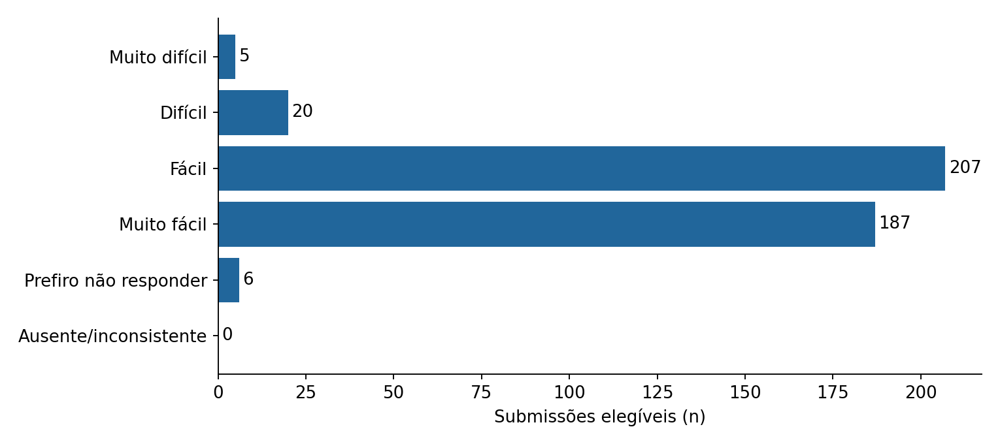
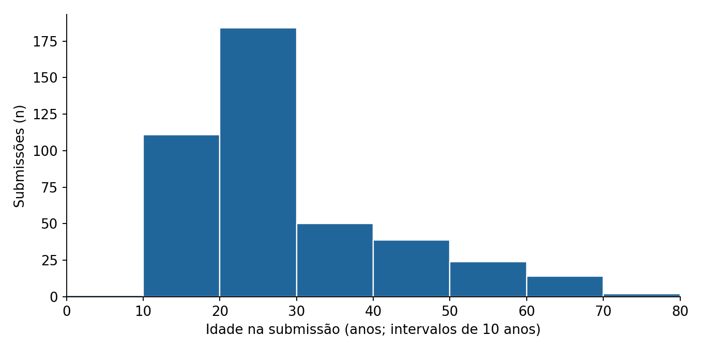
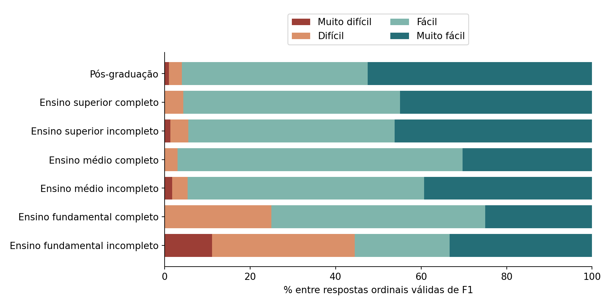

# Compreensão e facilidade do CHYPS-V BR

Base: **531 submissões**; incluídas por TR1: **425**; excluídas: **106**.

Mesma tradução Deepseek-v3.2 para todos; preenchimento autônomo, sem alterações na coleta ou reaplicações, conforme informado pelo responsável.

Período das submissões elegíveis (datas registradas): 2026-03-19 a 2026-11-08.

## Facilidade percebida (F1)

| Alternativa | n | % dos elegíveis |
|---|---:|---:|
| Muito difícil | 5 | 1.2% |
| Difícil | 20 | 4.7% |
| Fácil | 207 | 48.7% |
| Muito fácil | 187 | 44.0% |
| Prefiro não responder | 6 | 1.4% |
| Ausente/inconsistente | 0 | 0.0% |

Dificuldade (Muito difícil + Difícil): **25/419 (6.0%)** entre as quatro respostas ordinais válidas.
IC 95% de Wilson: **4.1% a 8.7%**.

Entre respostas ordinais válidas, 394/419 (94.0%) indicaram facilidade. A baixa escolaridade reúne poucos casos, com maior dificuldade descritiva; priorizar entrevistas cognitivas nesse público antes de concluir acessibilidade ampla.

Recusa explícita e ausência não recebem pontuação ordinal. O intervalo expressa precisão sob um modelo binomial; a seleção da amostra não garante representatividade populacional.

## Idade

Idades válidas: **425**; situações de leitura/validade: `{"valid": 425}`.
Mediana: **24 anos**; Q1–Q3: **19–33 anos**; limites observados: 9–71 anos.

Idade em anos completos na data da submissão; datas fora dos formatos explícitos ou idades fora de 0–120 anos são sinalizadas. Histograma em intervalos fixos de dez anos, incluindo apenas idades válidas.

## Escolaridade e facilidade

| Escolaridade | n | Difícil ou muito difícil / F1 válido |
|---|---:|---:|
| Ensino fundamental incompleto | 9 | 4/9 (44.4%) |
| Ensino fundamental completo | 8 | 2/8 (25.0%) |
| Ensino médio incompleto | 58 | 3/56 (5.4%) |
| Ensino médio completo | 35 | 1/33 (3.0%) |
| Ensino superior incompleto | 146 | 8/145 (5.5%) |
| Ensino superior completo | 69 | 3/69 (4.3%) |
| Pós-graduação | 100 | 4/99 (4.0%) |
| Prefiro não responder | 0 | 0/0 (não estimável) |
| Ausente/inconsistente | 0 | 0/0 (não estimável) |

## Idade e facilidade

| Idade | F1 válido | Difícil ou muito difícil |
|---|---:|---:|
| 0–17 | 63 | 6 (9.5%) |
| 18–29 | 228 | 12 (5.3%) |
| 30–44 | 64 | 3 (4.7%) |
| 45–59 | 49 | 3 (6.1%) |
| 60–120 | 15 | 1 (6.7%) |

As comparações por grupos são descritivas. Células pequenas exigem cautela; diferenças não demonstram efeito causal da idade ou da escolaridade.

## Observações (F2)

| Situação | n |
|---|---:|---:|
| marcador_na | 327 |
| comentario_com_conteudo | 76 |
| sem_observacao_explicita | 17 |
| sem_conteudo_interpretavel | 5 |

Leitura interpretativa pelo assistente de IA, única, com codificação conservadora multirrótulo, sem inferência clínica ou validação humana independente.

30 comentários receberam ao menos um dos temas abaixo; denominador de comentários com conteúdo: 76. Relatos exclusivamente pessoais ou clínicos não foram interpretados clinicamente. Comentários fora dos temas não significam avaliação positiva.

| Tema | n de comentários | % dos comentários com conteúdo |
|---|---:|---:|---:|
| Instruções ou exemplo inicial | 3 | 3.9% |
| Alternativas de resposta e categorias ausentes | 5 | 6.6% |
| Clareza, abstração ou conectivos | 2 | 2.6% |
| Contexto, memória ou aplicabilidade das situações | 7 | 9.2% |
| Sugestão de exemplos visuais | 1 | 1.3% |
| Extensão ou cansaço no preenchimento | 2 | 2.6% |
| Navegação e avanço de tela | 1 | 1.3% |
| Facilidade ou clareza explicitamente elogiada | 6 | 7.9% |
| Categorias sociodemográficas, inclusão ou cobertura | 7 | 9.2% |
| Informações do convite | 1 | 1.3% |

Codificação interpretativa assistida por IA, exploratória e multirrótulo, sem revisão humana independente ou estimativa de concordância entre avaliadores. Nenhum comentário individual é reproduzido.

## Interpretação e limitações

A conclusão refere-se às pessoas que acertaram TR1. Excluir quem não compreendeu essa instrução pode tornar a estimativa de facilidade mais favorável do que na base completa. TR1 serve somente para seleção e documentação.

F1 combina entender e responder o teste. F2 ajuda a localizar problemas, mas não separa de maneira experimental tradução, interface, memória e experiência com as situações. Facilidade autorrelatada não comprova adaptação transcultural, equivalência semântica ou validade psicométrica.

A distribuição completa de F1 é o resultado principal. Não foi definido limiar de aprovação, nem realizados testes de hipóteses pós-hoc. Q1–Q20, seus escores e os campos clínicos não entram nos cálculos.

## Reprodutibilidade e publicação

O script analyze_usability.py recebe o JSON e a revisão temática privados fora de qualquer checkout Git. Apenas agregados e figuras são gravados. summary.json registra parâmetros e hashes de integridade; a revisão privada é necessária para reproduzir a codificação temática. Sem ela, o script informa que a codificação está pendente.

Referência para o IC: Wilson (1927), Probable Inference, the Law of Succession, and Statistical Inference. DOI: 10.1080/01621459.1927.10502953.
